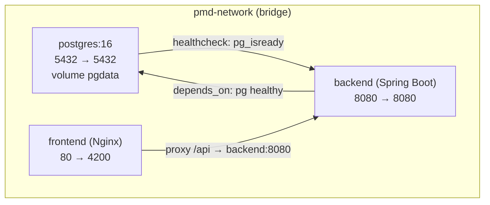

# Design 07 — Thiết kế triển khai local (Deployment Design)

> Dự án: PM Daily Work Management | Trạng thái: Draft — chạy local bằng Docker Compose (Windows) + phương án thủ công.
> Chi tiết vận hành: `docs/build/windows-local-runbook.md` (Prompt 25), `docs/build/docker-local-guide.md` (Prompt 24).

## 1. Tổng quan Docker Compose



| Service | Image/Dockerfile | Port (host → container) | Healthcheck |
|---|---|---|---|
| `postgres` | `postgres:16-alpine` | 5432 → 5432 | `pg_isready -U $POSTGRES_USER` |
| `backend` | `backend/Dockerfile` (multi-stage) | 8080 → 8080 | `GET /actuator/health` |
| `frontend` | `frontend/Dockerfile` (multi-stage + nginx) | 4200 → 80 | `GET /healthz` (nginx stub) |

## 2. Biến môi trường (`.env.example` → `.env`, không commit `.env`)

```dotenv
# PostgreSQL
POSTGRES_DB=pmdaily
POSTGRES_USER=pmdaily
POSTGRES_PASSWORD=change-me-local

# Backend
DB_URL=jdbc:postgresql://postgres:5432/pmdaily
DB_USERNAME=pmdaily
DB_PASSWORD=change-me-local
JWT_SECRET=change-me-local-secret-at-least-32-chars
JWT_ACCESS_EXPIRATION=900000
JWT_REFRESH_EXPIRATION=604800000
CORS_ALLOWED_ORIGINS=http://localhost:4200
SPRING_PROFILES_ACTIVE=local
```

- Backend container: dùng tên service `postgres` làm host; chạy thủ công local thì dùng `localhost:5432`.
- Không hard-code: mọi secret trong `.env`; nếu `JWT_SECRET` thiếu → backend fail fast khi start.

## 3. Dockerfile Backend (multi-stage)

```
Stage 1 build: maven:3.9-eclipse-temurin-21 → mvn clean package (skip tests ở image build? Không — chạy test rồi package)
Stage 2 run: eclipse-temurin:21-jre → COPY jar → ENTRYPOINT java -jar
```

## 4. Dockerfile Frontend (multi-stage) + Nginx

```
Stage 1 build: node:20-alpine (theo bản Node đã chốt) → npm ci → npm run build (production)
Stage 2 run: nginx:alpine → COPY dist → nginx.conf
```

`frontend/nginx.conf`:
- `location /` → SPA fallback `try_files $uri $uri/ /index.html;` (Angular route).
- `location /api/` → proxy_pass `http://backend:8080` (giữ prefix `/api/v1`).
- Static caching hợp lý (`index.html` no-cache; assets có cache fingerprint).

## 5. Các lệnh vận hành

| Lệnh | Mục đích |
|---|---|
| `docker compose up -d --build` | Build + start toàn bộ |
| `docker compose ps` | Kiểm tra trạng thái |
| `docker compose logs -f [service]` | Xem log |
| `docker compose down` | Dừng (giữ volume) |
| `docker compose down -v` | Dừng + xóa volume (reset DB) |
| `docker compose restart backend` | Restart 1 service |

## 6. Chạy thủ công (không Docker — Windows)

| Thành phần | Lệnh | Chuẩn bị |
|---|---|---|
| PostgreSQL | Docker riêng hoặc bản cài đặt local | DB `pmdaily`, user, password qua env |
| Backend | `cd backend; mvn clean test; mvn spring-boot:run -Dspring-boot.run.profiles=local` | `DB_URL=jdbc:postgresql://localhost:5432/pmdaily` |
| Frontend | `cd frontend; npm install; npm start` | Proxy dev `/api` → `http://localhost:8080` (angular.json) |
| Kiểm tra | Swagger `http://localhost:8080/swagger-ui.html`; Health `http://localhost:8080/actuator/health` | — |

## 7. Cấu hình theo môi trường (Backend)

| Profile | DB | Flyway | Seed | CORS |
|---|---|---|---|---|
| `local` | localhost/docker postgres | chạy V1 + V2 | V2 seed data demo | origin dev |
| `test` | DB test (Testcontainers hoặc H2 PG-mode — chốt khi implement) | chạy V1 | không seed | — |
| production (chưa dùng v1) | env var | chạy V1 | không seed | env var |

## 8. Migration & dữ liệu

- Flyway: `backend/src/main/resources/db/migration/V1__init_schema.sql`, `V2__seed_local_data.sql` (seed dành cho local — tài khoản demo ghi rõ trong README, password demo chỉ dùng local).
- `database/schema.sql` và `database/seed-data.sql` là bản tham chiếu cho migration (không chạy trực tiếp khi app chạy).
- Quy tắc: không sửa file migration đã chạy; thay đổi schema → tạo `V3__...`.

## 9. Port mặc định & xung đột

| Dịch vụ | Port | Lỗi hay gặp | Xử lý |
|---|---|---|---|
| PostgreSQL | 5432 | Port đã dùng (cài PostgreSQL local) | Đổi host port qua `.env` hoặc dừng dịch vụ local |
| Backend | 8080 | Port đã dùng | Đổi `BACKEND_PORT` compose |
| Frontend | 4200 | Port đã dùng (Angular dev) | `npm start -- --port 4201` |
| Frontend (Nginx) | 4200 | — | Đổi qua `.env` |

## 10. Các tệp dự kiến

```
docker-compose.yml
.env.example
backend/Dockerfile
frontend/Dockerfile
frontend/nginx.conf
scripts/start-local.ps1
scripts/stop-local.ps1
scripts/reset-local.ps1
scripts/smoke-test.ps1
scripts/backup-db.sh          # GĐ4 cải tiến — mục 13
scripts/restore-db.sh         # GĐ4 cải tiến — mục 13
docs/build/docker-local-guide.md     # Prompt 24
docs/build/docker-build-result.md    # Prompt 24
docs/build/windows-local-runbook.md  # Prompt 25
```

## 11. Kiểm chứng (Prompt 24/25)

- [ ] `docker compose up -d --build` chạy được trên Windows; cả 3 container healthy.
- [ ] Backend health 200; Swagger mở được; DB có migration V1 + V2.
- [ ] Frontend mở được, đăng nhập được bằng tài khoản demo seed.
- [ ] Proxy `/api` hoạt động (login qua nginx thành công).
- [ ] `docker compose down -v` rồi up lại → schema tự tạo lại (không lỗi migration).

## 12. Observability — Actuator metrics (GĐ4 cải tiến, 2026-11-12)

Trước đây Actuator chỉ expose `health,info`, không có metrics gì để theo dõi hệ thống đang chạy thế nào (JVM heap, HTTP request latency theo route, connection pool...). Đã thêm:

- **Dependency**: `io.micrometer:micrometer-registry-prometheus` (version theo Spring Boot BOM, không ghi cứng) — chuẩn công nghiệp, Prometheus server (hoặc Grafana Agent) scrape trực tiếp từ `/actuator/prometheus`, không cần backend tự đẩy đi đâu.
- **Endpoint mới**: `GET /actuator/metrics` (danh sách tên metric + xem chi tiết 1 metric qua `/actuator/metrics/{name}`), `GET /actuator/prometheus` (toàn bộ metric ở format Prometheus text, để scrape).
- **Bảo mật**: `/actuator/health` vẫn public (health probe không cần đăng nhập, `show-details: never` để không lộ chi tiết DB/disk ra ngoài); **mọi endpoint actuator khác** (`metrics`, `prometheus`, `info`) **chỉ ADMIN** — thêm rule riêng trong `SecurityConfig` (`requestMatchers("/actuator/**").hasRole("ADMIN")`), vì metric nội bộ (tên route, thời gian xử lý, connection pool) không nên lộ cho user thường.
- **Lưu ý khi test**: Spring Boot Test mặc định set `management.defaults.metrics.export.enabled=false` trong mọi `@SpringBootTest` (tránh overhead không cần thiết khi chạy test) — registry Prometheus dùng property riêng `management.prometheus.metrics.export.enabled`, nên phải set `true` tường minh trong `application.yml` (không dựa vào `management.defaults.*`) để endpoint `/actuator/prometheus` hoạt động nhất quán cả khi test và khi chạy thật.
- **Chưa làm (để lại cho giai đoạn vận hành thật sự, không phải phạm vi phiên này):** triển khai Prometheus/Grafana server thật để scrape + dashboard — phiên này chỉ đảm bảo backend "phơi" đúng đủ metric và bảo mật đúng; dựng hạ tầng giám sát thật cần quyết định hosting riêng (self-host hay managed).

**File cập nhật:** `backend/pom.xml` (+micrometer-registry-prometheus), `application.yml` (+metrics,prometheus trong exposure, +health.show-details: never, +prometheus.metrics.export.enabled), `SecurityConfig.java` (+rule ADMIN-only cho `/actuator/**`), `SecuritySmokeIntegrationTest.java` (+4 test: public health, 401 không auth, 403 non-admin, 200 admin cho metrics/prometheus).
**Kiểm tra:** `SecuritySmokeIntegrationTest` 8/8 PASS (4 cũ + 4 mới); `mvn test` toàn bộ backend.

## 13. Backup/restore PostgreSQL (GĐ4 cải tiến, 2026-11-12)

Trước đây không có chiến lược chính thức nào cho backup/restore. Production hiện tại chạy trên **Neon Postgres** (`render.yaml` — `ep-purple-dream-azkoyql8-pooler...neon.tech`), nên chiến lược phải tính tới điều này thay vì giả định "tự quản lý Postgres":

- **Lớp bảo vệ chính: Neon Point-in-Time Recovery (PITR).** Neon tự động giữ lịch sử thay đổi và cho phục hồi về 1 thời điểm bất kỳ trong khoảng retention của plan đang dùng (free plan hiện tại: theo giới hạn Neon công bố, cần PM xác nhận lại khi cần phục hồi thật — không nằm trong phạm vi code của app). Đây là cơ chế chính, **không cần code backend nào** để bật — chỉ cần biết nó tồn tại và vào đúng Neon console khi cần.
- **Lớp bổ sung: backup thủ công qua `pg_dump`/`pg_restore`.** Dùng khi cần: (1) bản sao ngoài Neon trước khi chạy migration rủi ro cao trên production, (2) xuất dữ liệu để chuyển sang hosting khác, (3) lưu trữ dài hạn vượt quá retention PITR của Neon. Script:
  - `scripts/backup-db.sh` — đọc `DB_URL`/`DB_USERNAME`/`DB_PASSWORD` (cùng biến môi trường backend đang dùng, tự parse JDBC URL ra host/port/dbname/sslmode), chạy `pg_dump --format=custom` ra file `.dump` có timestamp trong `./backups/` (hoặc `$BACKUP_DIR`).
  - `scripts/restore-db.sh <file.dump>` — chạy `pg_restore --clean --if-exists`, **bắt buộc gõ lại đúng tên database đích để xác nhận** trước khi ghi đè (an toàn khi lỡ chạy nhầm DB_URL).
- **Quy tắc vận hành:**
  - **Không commit file `.dump` vào git** — chứa toàn bộ dữ liệu production (PII). Lưu ở nơi riêng (private object storage/đĩa mã hoá), script tự nhắc khi chạy xong.
  - Trước mỗi migration Flyway mới chạy trên production → chạy `backup-db.sh` trước, giữ lại tối thiểu 1 bản gần nhất.
  - Restore luôn chạy trên 1 bản sao/branch thử nghiệm trước (Neon hỗ trợ tạo branch riêng từ 1 thời điểm PITR để test an toàn, không ảnh hưởng nhánh chính) — không restore trực tiếp lên production khi chưa kiểm chứng.

**Chưa làm (ngoài phạm vi phiên này, cần hạ tầng/quyết định riêng):**
- Lên lịch backup tự động (cron/cloud scheduler) — phiên này chỉ có script chạy thủ công, chưa gắn vào đâu để tự chạy định kỳ; cần quyết định nơi chạy (GitHub Actions scheduled job, hay 1 service riêng) trước khi tự động hoá.
- **Chưa chạy restore thật để kiểm chứng** — môi trường phiên này không có quyền tạo Neon branch thử nghiệm hoặc Postgres thật để test full cycle backup→restore; mới kiểm tra được: cú pháp bash hợp lệ (`bash -n`) và logic parse JDBC URL ra đúng host/port/dbname/sslmode cho cả 2 kiểu URL (Neon có `sslmode=require`, docker-compose local không có query string). **Trước khi dùng thật trên production, cần chạy thử restore 1 lần trên Neon branch tạm để xác nhận toàn bộ chu trình.**

**File tạo mới:** `scripts/backup-db.sh`, `scripts/restore-db.sh`.
